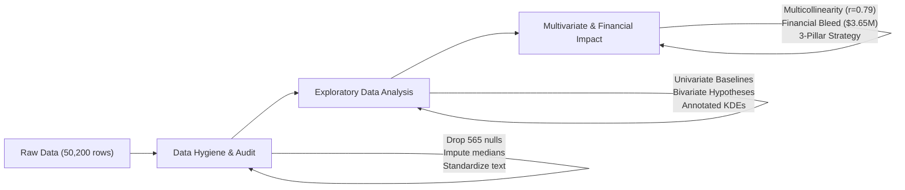

# 📞 Telecom Customer Churn & Revenue Risk Analysis

[](https://www.python.org/)
[](https://pandas.pydata.org/)
[](https://seaborn.pydata.org/)
[](https://opensource.org/licenses/MIT)

## 📌 Executive Summary
Customer attrition in subscription-based telecommunications businesses directly degrades recurring revenue and customer lifetime value (LTV). This project investigates customer behavior across **49,635 validated accounts** (~$3.0M Monthly Recurring Revenue) to isolate the core drivers and behavioral indicators of churn.

The analysis identified an **annual revenue bleed of $3,653,533.68** (~$304.5K/month) driven primarily by **involuntary billing friction** (+95% payment failures) and **service friction** (+74% support tickets), rather than monthly subscription pricing. A data-driven 3-pillar retention strategy is proposed, projected to protect **$548,030.05 annually** at a conservative 15% churn reduction.

---

## 🔍 Key Findings

| Metric / Dimension | Retained Baseline | Churned Group | Impact / Difference | Strategic Takeaway |
|---|---|---|---|---|
| **Payment Failures (12m)** | 0.40 | 0.78 | **+95.0%** | Involuntary churn caused by billing/gateway failure is the #1 catalyst. |
| **Support Tickets (90d)** | 0.77 | 1.34 | **+74.0%** | Unresolved technical and service friction accelerates customer departure. |
| **Last Login Inactivity** | 12.8 days | 25.9 days | **+100.0%** | Extended inactivity is the primary leading behavioral warning signal. |
| **Average Tenure** | 22.8 mos | 17.0 mos | **-25.8%** | Critical attrition risk concentrates between months 12 and 18. |
| **Monthly Charges** | $59.48 (med) | $56.32 (med) | ~Equal | Price sensitivity is **not** a primary churn driver. |
| **Subscription Tier** | Standard: 8.6% | Premium: 11.1% | **+2.5% pts** | Premium subscribers churn fastest due to unmet value-to-cost expectations. |

---

## 🏗️ Repository Architecture
```text
├── data/
│   └── telecom.csv                 # Raw dataset (50,200 records x 18 features)
├── notebooks/
│   └── telecom_churn_deep_dive_analysis.ipynb      # Complete 4-phase Jupyter/VS Code analysis
├── README.md                       # Executive project briefing & documentation
└── requirements.txt                # Python environment dependencies
```

---

## 🛠️ Data Pipeline & Methodology



1. **Phase 1: Ingestion & Profiling:** Evaluated data dimensions (50,200 rows, 18 columns) and audited missing values.
2. **Phase 2: Data Hygiene Protocol:**
   - Confirmed 0 duplicate records / unique `customer_id` primary keys.
   - Standardized `region` casing to Title Case, consolidating 10 dirty entries into 5 validated territories.
   - Parsed `signup_date` to native `datetime64[ns]` for cohort modeling.
   - Imputed median age (41.0) and median session length (24.0 min); encoded missing satisfaction scores as `0` (non-respondents); dropped 565 rows (~1.1%) missing `total_charges`.
3. **Phase 3: Exploratory Data Analysis & Hypothesis Testing:**
   - *Hypothesis 1 (Pricing/Tiers):* Verified that churn rate does not correlate with monthly charges; isolated higher churn in Premium (11.1%) and Basic (11.0%) vs. Standard (8.6%).
   - *Hypothesis 2 (Operational Friction):* Identified severe surges in support escalations (+74%) and payment failures (+95%).
   - *Hypothesis 3 (Lifecycle Decay):* Built annotated KDE distribution plots revealing that churned users show near-zero login activity for 25.9 days prior to exit.
4. **Phase 4: Multivariate Correlation & Financial Modeling:**
   - Mapped multicollinearity between `tenure_months` and `total_charges` ($r = 0.79$).
   - Quantified total annual financial risk (\$3.65M) and projected ROI on targeted churn intervention.

---

## 💡 Strategic Recommendations

### 1. Smart Dunning & Involuntary Churn Prevention (Pillar 1)
Deploy automatic card account updater integrations and multi-step dunning retry logic (SMS + email notification on Day 1, 3, and 5 post-failure) to recapture up to 40% of billing-driven attrition.

### 2. Early-Warning Inactivity Workflows (Pillar 2)
Implement an automated event trigger at the **14-day inactivity mark**:
* **Day 14:** Trigger automated re-engagement email highlighting new features or unused benefits.
* **Day 21:** Dispatch proactive survey and customer support check-in.

### 3. Premium VIP Routing (Pillar 3)
Route accounts with $\ge 2$ support tickets in 90 days or those paying Premium tier fees to dedicated Tier-2 senior resolution specialists to close the value-perception gap.

---

## 🚀 How to Run Locally

### Prerequisites
* Python 3.10 or 3.11 installed
* VS Code or Jupyter Notebook environment

### Installation & Execution
```bash
# 1. Clone the repository
git clone https://github.com/your-username/telecom-customer-churn-analysis.git
cd telecom-customer-churn-analysis

# 2. Create and activate a virtual environment
python -m venv .venv
# On Windows:
.venv\Scripts\activate
# On macOS/Linux:
source .venv/bin/activate

# 3. Install required libraries
pip install pandas numpy matplotlib seaborn jupyter

# 4. Launch the notebook
jupyter notebook notebooks/telecom_Analyzed.ipynb
```

---

## 👤 Author
**Mohamed Ali Hassan**  
*Data Analyst | Python · Advanced Google Sheets · SQL*  
Cairo, Egypt | [LinkedIn Profile](www.linkedin.com/in/mohamed-ali-29937656) | [Upwork Profile](https://www.upwork.com/freelancers/~0187fdaf1aefb8f119)
